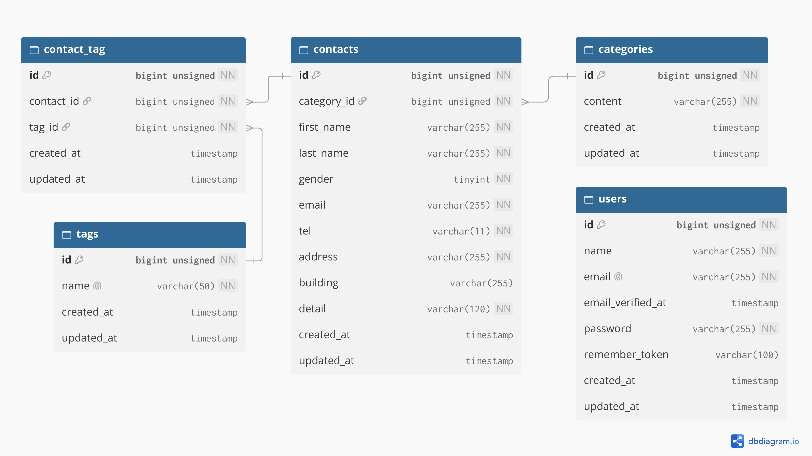

# COACHTECH お問い合わせフォーム

## 概要
本プロジェクトは、ユーザーからのお問い合わせを受け付ける公開画面と、管理者がデータを確認・管理できる管理画面を備えたLaravelアプリケーションです。
お問い合わせの投稿、バリデーション制御、カテゴリ紐付け、タグ管理、および認証機能などの実践的なWebアプリケーション機能を実装しています。


## ER図



## 使用技術（技術スタック）
- **Backend**: PHP, Laravel
- **Frontend**: Vite, Blade, Tailwind CSS
- **Database**: MySQL 8.0
- **Server**: Nginx (Docker環境)
- **Environment**: Docker / Laravel Sail


## 環境構築手順
1. **リポジトリのクローンと移動**
```bash
git clone https://github.com/ayami-makita/contact-form-app
cd contact-form-app
```
2. **環境変数ファイルの作成**
```bash
cp .env.example .env
```
.env ファイルを開き、データベース接続情報が以下と一致していることを確認します。
- DB_CONNECTION=mysql
- DB_HOST=mysql
- DB_PORT=3306
- DB_DATABASE=laravel
- DB_USERNAME=sail
- DB_PASSWORD=password
重要: DB_HOST は localhost や 127.0.0.1 ではなく、Dockerコンテナ名である mysql を指定します。"

3. **Composerの依存関係インストール**
```bash
composer install
```

4. **Laravel Sailの起動**
```bash
./vendor/bin/sail up -d
```

5. **アプリケーションキーの生成**
```bash
./vendor/bin/sail artisan key:generate
```

6. **データベースのマイグレーションとシーディング**
```bash
./vendor/bin/sail artisan migrate --seed
```

7. **.Vite開発サーバーの起動**
```bash
sail npm run dev
```

補足：Sailコマンドのエイリアス設定（推奨）
毎回 ./vendor/bin/sail と入力する代わりに sail コマンドで実行できるようにするための設定です。
- Bashの場合
```bash
echo "alias sail='[ -f sail ] && bash sail || bash vendor/bin/sail'" >> ~/.bashrc
```
- 設定を反映するため、シェルを再起動
```bash
exec \$SHELL
```


## APIエンドポイント一覧
**公開画面**  
メソッド   パス                  概要  
GET        /                    お問い合わせ入力画面（トップ）  
POST       /contacts/confirm    お問い合わせ内容確認画面  
POST       /contacts            お問い合わせデータ保存処理  
GET        /thanks              サンクスページ（送信完了）  　

**管理画面（要認証）**  
メソッド   パス                         概要  
GET        /admin                      管理画面一覧・検索表示  
GET        /admin/contacts/{contact}   お問い合わせ詳細表示  
DELETE     /admin/contacts/{contact}   お問い合わせ削除処理  
POST       /admin/tags                 タグ新規登録処理  
PUT        /admin/tags/{tag}           タグ更新処理  
DELETE     /admin/tags/{tag}           タグ削除処理  

## 開発環境URL
お問い合わせフォーム: http://localhost
ログイン画面: http://localhost/login

## 作成者
牧田　彩実
